 

## Featured Work

<b>Try them live:</b>
<a href="https://reforge-181098358760.us-central1.run.app/">Reforge demo</a> ·
<a href="https://youtu.be/5xdMIWb8mXc">video</a> &nbsp;|&nbsp;
<a href="https://siliconloop-161403134431.us-central1.run.app">SiliconLoop demo</a> ·
<a href="https://youtu.be/ltlNKccoAkQ">video</a>

## Stack

## Activity

